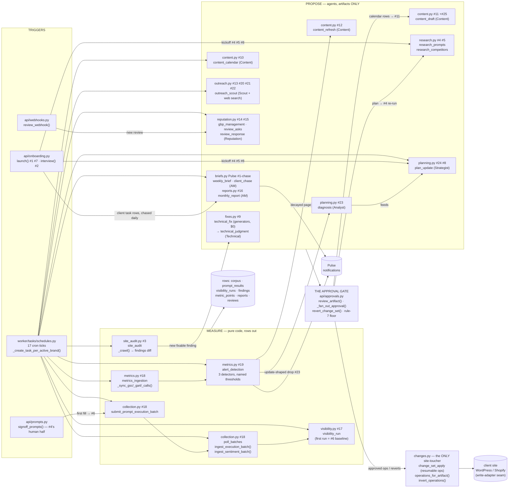

# evergreen-backend

Evergreen — the SEO agency in your pocket. One repo, one Docker image, **two Railway
services** that differ only by start command:

| Service | Start command | Job |
|---|---|---|
| `api` | (image CMD) `uvicorn main:app --host 0.0.0.0 --port $PORT` | REST endpoints, authz, Ask (sync Analyst) |
| `worker` | `python -m worker.run` (custom start command) | pipelines, agent runtime, change-set engine |

They never call each other — **Postgres is the contract** (the task queue is the
handoff). Sole exception: Ask streams through the LLM adapter directly.

Design source of truth (live artifacts):
- [System design doc](https://claude.ai/code/artifact/abf28a78-3838-4eb0-a88a-8323a0528a6c) — architecture, full column spec, queue contract
- [UI mockup](https://claude.ai/code/artifact/17c0d228-c643-4012-ae95-368d0b316d90) · [Onboarding flow](https://claude.ai/code/artifact/88b641ff-6385-4d9b-ad3c-0096daaeac5c)

## The 26 deliverables → where they live

The design doc's "26 deliverables — why these workers exist" card is the
product's table of contents; this maps each row to code. Every `#N` comment
across `worker/` refers to this numbering. Cadence triggers all live in
`worker/tasks/schedules.py` (one cron per scheduled deliverable; the ones that
deliberately do NOT ride cron are documented in its bottom comment).
*(planned)* = the file documents the deliverable but the task/router is not
built yet — chained/event runners register in the same change as their producer.

### One-time: onboarding (month 1)

| # | Deliverable | Where it lives |
|---|---|---|
| 1 | Access provisioning | `api/onboarding.py` *(planned)* creates the client-task rows (no queue job); `worker/tasks/briefs.py` `client_chase` nags them daily |
| 2 | Kickoff interview → business context | `api/onboarding.py` *(planned)*, AM-conducted → `brands` context fields |
| 3 | Full technical audit | `worker/tasks/site_audit.py` (fires at launch, then weekly) |
| 4 | Keyword + AI-prompt research | `worker/tasks/research.py` *(planned)* `research_prompts`, fired by onboarding, re-fired by plan updates |
| 5 | Competitor & citation-source gap analysis | `worker/tasks/research.py` *(planned)* bootstrap + `worker/tasks/collection.py` continuous ~5% discovery sampling |
| 6 | Baseline report | the brand's first run of `worker/tasks/visibility.py` + `worker/tasks/reports.py`, fired by onboarding |
| 7 | Conversion tracking setup | `api/onboarding.py` *(planned)* config + a client verification task (chased via `briefs.py`) |
| 8 | 6-month strategy roadmap | the first `plan_update` in `worker/tasks/planning.py`, fired by onboarding |

### Monthly recurring (the retainer's core)

| # | Deliverable | Where it lives |
|---|---|---|
| 9 | Technical fixes from ongoing monitoring | `worker/tasks/fixes.py` (`technical_fix`: per-kind generators or ONE Technical-agent run per audit with CMS read tools, `TECHNICAL_FIX_MODE`; `technical_judgment` = generators-mode escalation), chained once per audit from `site_audit.py`; playbooks in `skills/seo/` |
| 10 | Content calendar | `worker/tasks/content.py` `content_calendar` (monthly cron) |
| 11 | New content produced & published | `worker/tasks/content.py` `content_draft` *(planned)* — fans out from the APPROVED calendar, never cron |
| 12 | Existing-page optimization / refresh | `worker/tasks/content.py` `content_refresh` *(planned)* — chained from `alert_detection` |
| 13 | Link building / digital PR placements | `worker/tasks/outreach.py` `outreach_scout` (`citation_targets` scan) |
| 14 | GBP management (posts, review responses) | `worker/tasks/reputation.py` `gbp_management` + webhook-fired `review_response`; approval chains `gbp_apply` (Q&A cut — Google killed its API 2025-11) |
| 15 | Review generation campaign | `worker/tasks/reputation.py` `review_asks` |
| 16 | Monthly report + walkthrough | `worker/tasks/reports.py` `monthly_report` |
| 17 | AI visibility / share-of-voice report | `worker/tasks/visibility.py` `visibility_run` (weekly trend point) |

### Weekly / daily (where retention is won)

| # | Deliverable | Where it lives |
|---|---|---|
| 18 | Rank + AI-answer movement monitoring | `worker/tasks/collection.py` (submit/poll batches → shared corpus) + `worker/tasks/metrics.py` `metrics_ingestion` |
| 19 | Alerting (index drops, site down, CWV regressions) | `worker/tasks/metrics.py` `alert_detection` — also the producer of #12 and #23 |
| 20 | Journalist-request responses (same-day deadlines) | `worker/tasks/outreach.py` `outreach_scout` (`journalist_requests` scan, daily) — TODO(#20): Connectively/Qwoted adapters |
| 21 | Community thread opportunities | `worker/tasks/outreach.py` `outreach_scout` (`community_threads` scan) |
| 22 | Unlinked mention reclamation | `worker/tasks/outreach.py` `outreach_scout` (`unlinked_mentions` scan) |
| 23 | Algorithm-update triage | `worker/tasks/planning.py` `diagnosis` *(planned)* — chained from `alert_detection`, "as needed" has no cron |

### Quarterly

| # | Deliverable | Where it lives |
|---|---|---|
| 24 | Strategy review + roadmap refresh | `worker/tasks/planning.py` `plan_update` (quarterly cron) |
| 25 | Original data study | plan-driven: #24 emits it; the client collects the data (chased via `briefs.py`); the write-up rides `content.py`'s `content_draft` |
| 26 | Competitor landscape re-baseline | covered by `collection.py`'s continuous discovery sampling — no separate runner on purpose |

Cross-cutting, un-numbered: the Pulse weekly brief + client chase
(`worker/tasks/briefs.py`), the agent program (`adapters/agents/claude_agent.py`)
with its role prompts (`utils/agent_prompts.py`), and the queue contract
(`utils/task_queue.py` — `create_task` + `task_lifecycle`).

## Pipeline map — walking the 26 through the code

Read it left to right: **triggers** create typed tasks → **measure** runners
produce rows ($0, no LLM) → **propose** runners are agent calls that only ever
emit artifacts → the **approval gate** fans approved work out → the
**change-set engine** is the single thing that touches a client's site.



Ground-level detail, one line per worker file (task functions first, load-bearing
helpers after the dash):

```
worker/tasks/
├── schedules.py    17 @app.periodic ticks, one per scheduled deliverable — the
│                   cadence roster; non-cron deliverables listed in its bottom comment
├── collection.py   submit_prompt_execution_batch · poll_batches — corpus dedup,
│                   ingest_execution_batch, ingest_sentiment_batch, sentiment packs
├── visibility.py   visibility_run — framework 1.0.0 calculators, week_of_today,
│                   hydrate_prompt_result
├── site_audit.py   site_audit — robots_blocked_agents, page_findings, _crawl,
│                   findings diff (dedupe + auto-resolve), chains technical_fix
├── fixes.py        technical_fix · technical_judgment — _generate_fix (kind→fix map),
│                   _schema_markup, fetch_page_html/visible_text (shared)
├── metrics.py      metrics_ingestion · alert_detection — SYNC_BY_PROVIDER seam,
│                   _check_site_reachability, _detect_traffic_drop, _detect_page_decay
├── content.py      content_calendar · content_draft · content_refresh —
│                   _assemble_calendar_facts, _visibility_gaps, _parse_calendar_entries
├── briefs.py       weekly_brief · client_chase — _assemble_brief_facts,
│                   completed_task_counts/overdue_client_tasks (shared), CHASE_* knobs
├── outreach.py     outreach_scout — SCAN_BRIEFS (4 hunting grounds), WEB_SEARCH_TOOL
├── reputation.py   gbp_management · review_asks · review_response — template no-op
│                   guard, NEGATIVE_RATING_MAX
├── reports.py      monthly_report — _assemble_report_facts, idempotent by period
├── planning.py     plan_update · diagnosis — _assemble_plan_facts,
│                   _assemble_diagnosis_facts (dated timeline)
├── research.py     research_prompts · research_competitors — task-specific static
│                   system prompts (not roles)
└── changes.py      change_set_apply — operations_for_artifact, invert_operations,
                    APPLY_ENABLED_PLATFORMS + per-platform write seam
```

The connective tissue: `utils/task_queue.py` (`create_task` = row + job in one
commit; `task_lifecycle` = the runner wrapper), `adapters/agents/claude_agent.py`
(`run_role`/`run_agent` — per-turn cost events), `utils/agent_prompts.py` (the
seven role personas), `utils/agent_json.py` (`parse_agent_json` — the strict-JSON
output contract every agent runner uses).

## Quickstart

```bash
cp .env.example .env    # local defaults need nothing filled in
make start              # postgres :5432 + api :8000 + worker
                        # (migrations + queue schema auto-apply on boot)
make migration "initial schema"   # first run: autogenerate 0001 from objects/
make upgrade
make check              # flake8 + mypy + black/isort --check + pytest
```

Smoke check: `curl localhost:8000/` returns project/environment/version.

## Deploying to Railway

One project, three services:

1. **Postgres** — Railway's plugin; put its pieces into both services below as
   `DATABASE_HOST/NAME/USERNAME/PASSWORD/PORT` (+ `ENVIRONMENT=staging|production`).
2. **api** — this repo (Dockerfile build). Settings in the Railway dashboard (no
   config-as-code; Railway deprecated it): pre-deploy command `alembic upgrade head`,
   healthcheck path `/`.
3. **worker** — this repo, same image. Custom start command `python -m worker.run`;
   no pre-deploy, no healthcheck, no public domain. Keep App Sleeping OFF.

Both services get the same variables (`TOKEN_ENCRYPTION_KEY` must match). Full sheet:
`../evergreen-verification/railway-env.md`.

**Brand-new database only (once):** the job-queue tables aren't an Alembic migration.
After the first `alembic upgrade head`, run `procrastinate --app=worker.app.app schema --apply`
once (e.g. `railway ssh --service api`). Re-running it fails on an existing schema,
which is why it isn't part of the pre-deploy command.

## Repo map (geoviz-backend conventions)

```
main.py            FastAPI app: CORS → routers → middleware stack (ISE → DBSession → Logging → Trace)
bootstrap.py       logging + trace init (imported first by both services)
context.py         ContextVars: database_session, trace_id
settings/          __init__.py picks settings.{ENVIRONMENT}; base.py = shared;
                   local.py hardcodes docker Postgres; staging/production read flat env vars
api/               thin routers, one file per resource, all under /api/v1
objects/           SQLModel tables, ONE FILE PER TABLE, active-record static methods
                   (reads via ReplicaDatabase.session, writes via Database.session;
                   flush inside requests, never commit — middleware owns the transaction)
schemas/           pydantic request/response models per resource
middleware/        the four-middleware stack (same as geoviz-backend)
worker/            worker entrypoint + procrastinate app + tasks/
adapters/          the ONLY door to the outside world; every call meters a cost_event
utils/             database singletons, logger, trace
exceptions/        HTTPException subclasses (404s etc.)
alembic/           migrations — new table? import it in alembic/env.py or
                   autogenerate won't see it
tests/             pytest, runs in compose (make test k=expr)
```

Gotchas (inherited from geoviz-backend, still true here):
- New SQLModel tables must be **imported in `alembic/env.py`**.
- Alembic connects via pg8000 (env.py builds the URL from settings); the app uses asyncpg.
- `isort` must run with `--profile black` (the Makefile passes it).
- Inside a request, methods `flush()` but **never `commit()`** — the
  DatabaseSessionMiddleware wraps the whole request in one transaction.
- Standalone worker code opens its own
  `async with Database().connection():` and commits explicitly.

## Rules that are architecture, not style

1. **Agents emit artifacts, never side effects.** Execution belongs to the
   change-set engine, behind the approval gate.
2. **Queue contract:** the library (Procrastinate) owns claims/retries/leases;
   app code owns idempotent apply, lifetime token budgets, per-org in-flight
   caps, and granularity (a task = unit of retry/approval, never iteration).
3. **query_responses are brand-less and insert-only**; markets are shared, one
   row per physical city — or the corpus dedup breaks.
4. **Typed columns for anything filtered or aggregated; jsonb only for payloads
   read whole.**
5. **Every machine-created row carries `source`.** The system may revise its own
   rows, never a human's.
6. **All external spend crosses the adapter layer** and logs a cost_event.
